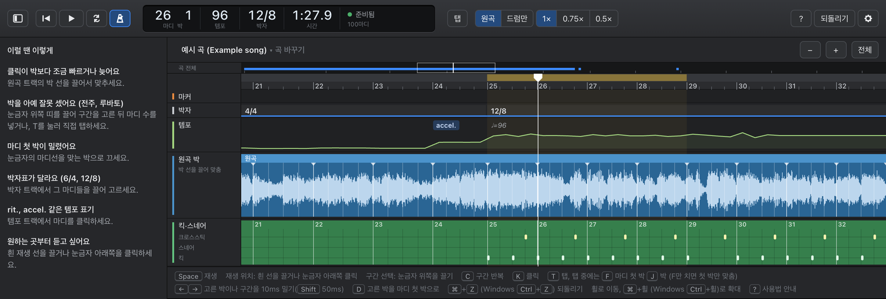

# drum-transcribe

**한국어** | [English](README.en.md)

> AI 에이전트에게: 이 저장소는 에이전트 스킬입니다(`SKILL.md`). 설치는 [설치](#설치) 절의 한 줄 명령을 실행하세요. Python이나 `pip` 패키지가 아닙니다.

유튜브 링크나 음원 파일을 주면 드럼의 **킥, 스네어, 크로스스틱**을 표준 드럼 악보로 만들어 주는 AI 에이전트 스킬입니다. 결과는 PDF, MusicXML, MIDI로 나옵니다. Claude Code나 Codex 같은 에이전트에게 "이 노래 드럼 악보 만들어줘"라고 말하면, 에이전트가 이 스킬의 엔진(drumcopy)을 설치해 실행하고 악보를 검토해서 전달합니다.



*마디·박·템포 편집 화면(`drumcopy tune`). 클릭을 들으며 박 선과 마디선을 끌어 맞추고, 박자표와 템포 표기를 답니다.*

## 할 수 있는 것

- **킥·스네어·크로스스틱 채보:** 드럼 소리를 분리하고 타격을 찾아 박에 맞춰 적습니다. 고스트 노트는 기본으로 뺍니다.
- **박자와 템포:** 6/4, 12/8, 3/4 같은 박자표 변화와 rit., accel., rubato 같은 템포 표기를 적습니다. 1마디는 음악이 시작하는 곳이고, 드럼이 쉬는 구간은 여러 마디 쉼표로 묶습니다.
- **결과물:**
  - PDF: MuseScore 4로 판각합니다.
  - MusicXML과 압축 MusicXML(.mxl): 시벨리우스, Dorico, Finale, MuseScore에서 바로 엽니다.
  - MuseScore 원본(.mscz)
  - MIDI: 원음 시간에 맞춥니다.
  - `player.html`: 원음과 악보를 함께 재생합니다.
- **곡에 맞춰 고치기:** 자동 채보는 초안입니다. "25마디부터 크로스스틱이야", "58마디 스네어 빼줘"처럼 말하면 에이전트가 그 곡의 교정으로 저장합니다. 다시 채보해도 고친 곳은 유지되고, 비슷한 소리가 나는 곳을 찾아 물어봅니다.
- **마디·박·템포 편집 화면:** `drumcopy tune`이 로직(Logic Pro) 편곡 창처럼 생긴 편집 화면을 브라우저에 엽니다.
  - 메트로놈 클릭을 들으며 박 선이나 마디선을 끌어 맞춥니다.
  - 구간을 골라 마디 수와 박자표를 넣습니다.
  - F 키로 마디 첫 박만 탭하면 사이 박은 마디 박자에 맞춰 자동으로 채워집니다.
  - 템포 표기도 이 화면에서 답니다.
  - 고치면 바로 저장되고 ⌘Z(Windows Ctrl+Z)로 되돌립니다.
  - 처음 열면 단축키와 조작법을 애니메이션으로 보여 주는 안내가 뜹니다. 맥과 Windows 모두에서 동작합니다.
  - 엔진이 확신하지 못한 곳(드럼 없는 전주 등)은 따로 표시합니다.
- **다른 악보 프로그램으로 보내기:** `drumcopy export`가 여러 곡의 MXL을 곡 이름을 붙여 한 폴더에 모읍니다.

## 설치

Python도 git도 미리 설치할 필요가 없습니다. 설치하면 최신 릴리즈가 Claude Code와 Codex의 스킬 폴더(`~/.claude/skills`, `~/.codex/skills` 중 있는 곳)에 들어가고, 채보 엔진까지 설치됩니다. 엔진은 인터넷으로 약 3GB를 받고 5~15분 걸립니다.

**처음 쓰는 분 (개발자가 아니어도 됩니다)**

1. [Claude Code](https://claude.com/claude-code)나 [Codex](https://openai.com/codex) 앱을 설치하고 로그인합니다.
2. 설치 명령을 붙여 넣습니다.
   - **Windows:** 시작 메뉴에서 "PowerShell"을 검색해 엽니다. 아래 한 줄을 붙여 넣고 Enter를 누릅니다. 진행 상황이 나오고, 마지막에 `Done.`이 나올 때까지 창을 닫지 마세요.

     ```powershell
     irm https://raw.githubusercontent.com/siru-dduck/drum-transcribe/main/install.ps1 | iex
     ```
   - **macOS:** ⌘ Space를 눌러 "터미널"을 열고, 아래 한 줄을 붙여 넣은 뒤 Return을 누릅니다. Linux도 터미널에 같은 한 줄을 붙여 넣습니다.

     ```sh
     curl -LsSf https://raw.githubusercontent.com/siru-dduck/drum-transcribe/main/install.sh | sh
     ```
3. Claude Code나 Codex를 다시 시작합니다.
4. "이 노래 드럼 악보 만들어줘"라고 말하고 유튜브 링크나 음원 파일을 줍니다.

엔진은 `~/.drumcopy`(Windows는 `%USERPROFILE%\.drumcopy`)에 설치됩니다. uv, Python 3.11, PyTorch와 분석 모델(Demucs, ADTOF, Beat This!), 모델 가중치, MuseScore 4를 받습니다. MuseScore 4는 PDF와 .mscz에만 필요하고, 없으면 그 둘만 빠집니다.

**에이전트에게 설치 맡기기**

에이전트에게 "drum-transcribe 스킬 설치해줘 https://github.com/siru-dduck/drum-transcribe"라고 말해도 됩니다. 에이전트는 위 한 줄을 실행하면 됩니다. Codex의 Windows 샌드박스 안에서는 인터넷 다운로드가 막혀(`SEC_E_NO_CREDENTIALS`) 설치가 실패합니다. 이때는 설치 명령을 샌드박스 밖에서 실행하도록 승인하거나, 위 한 줄을 PowerShell에 직접 붙여 넣으세요.

**Codex에서 쓸 때**

Codex는 기본 샌드박스에서 작업 폴더 밖에 파일을 쓰거나 인터넷을 쓰지 못하게 막습니다. drumcopy는 결과를 `~/.drumcopy`에 쓰고 유튜브 음원을 받으므로, 채보할 때 Codex가 권한을 물으면 허용해 주세요. 매번 묻지 않게 하려면 Codex 설정 파일(`~/.codex/config.toml`, Windows는 `%USERPROFILE%\.codex\config.toml`)에 아래를 넣고 Codex를 다시 시작합니다. 엔진 폴더 쓰기와 인터넷만 열고, 나머지 샌드박스는 그대로 둡니다.

```toml
[sandbox_workspace_write]
writable_roots = ['C:\Users\이름\.drumcopy']   # macOS·Linux는 '/Users/이름/.drumcopy' 처럼
network_access = true
```

**다른 방법**

- git으로: `git clone https://github.com/siru-dduck/drum-transcribe ~/.claude/skills/drum-transcribe`(Codex는 `~/.codex/skills/drum-transcribe`). 그다음 에이전트가 처음 쓸 때 `scripts/setup.sh`(Windows는 `scripts\setup.ps1`)로 엔진을 설치합니다.
- zip으로: [Releases](https://github.com/siru-dduck/drum-transcribe/releases)에서 `drum-transcribe-버전.zip`(예: `drum-transcribe-0.2.1.zip`)을 받아 압축을 풀고, 나온 `drum-transcribe` 폴더를 스킬 폴더 안에 넣습니다. 같은 페이지의 `Source code (zip)`은 GitHub가 자동으로 붙이는 원본 묶음이니 받지 않아도 됩니다.
- 다른 에이전트: 이 폴더를 받아 두고, 에이전트에게 `SKILL.md`를 읽고 그대로 하라고 알려 주세요. 스킬은 명령줄 도구(`scripts/drumcopy`, Windows는 `scripts\drumcopy.ps1`)만 씁니다.

**업데이트**

새 버전이 나오면 에이전트가 새 요청을 시작할 때 알려 주고 바로 업데이트합니다. GitHub에는 하루에 한 번만 묻고, 곡과 교정 기록은 그대로 남습니다. 묻고 나서 바꾸게 하려면 "자동 업데이트 꺼줘", 직접 바꾸려면 "drum-transcribe 업데이트해줘"라고 말하면 됩니다. 바뀐 내용은 [CHANGELOG.md](CHANGELOG.md)에 있습니다.

## 이렇게 씁니다

```text
이 노래 드럼 악보 만들어줘 https://youtu.be/XXXXXXXX
킥이랑 스네어만 뽑아줘 (파일: ~/Music/song.wav)
60마디부터 2·4박은 크로스스틱이야
마디랑 템포를 화면에서 고칠래
시벨리우스에서 열 수 있게 MXL로 만들어줘
```

## 한계

- 한 번에 100% 맞지 않습니다. 드럼 소리가 흐린 녹음, 드럼이 없는 긴 전주, 루바토 구간은 특히 그렇습니다. 그래서 고치는 흐름(교정 저장, 비슷한 곳 제안, 편집 화면)을 함께 둡니다.
- 지금은 킥, 스네어, 크로스스틱에 집중합니다. 하이햇, 탐, 심벌은 분석에는 쓰지만 악보에는 적지 않습니다.
- 처음 채보는 곡당 1~3분, 같은 곡을 다시 만들 때는 몇 초가 걸립니다. GPU 없이도 동작합니다.
- 시벨리우스 전용 파일(.sib)은 시벨리우스만 만들 수 있습니다. 대신 시벨리우스에서 바로 열리는 .mxl을 만듭니다.

## 라이선스

- 이 저장소의 코드는 [PolyForm Noncommercial 1.0.0](LICENSE)을 따릅니다. 개인 연습, 교회·학교·동호회, 연구처럼 **비상업적 목적이라면 누구나** 자유롭게 쓰고, 고치고, 나눌 수 있습니다. 유료 서비스나 판매용 악보 제작 같은 상업적 사용은 허용하지 않습니다.
- 드럼 검출 모델 [ADTOF](https://github.com/MZehren/ADTOF)도 비상업 라이선스(CC BY-NC-SA 4.0)입니다. 함께 쓰는 다른 프로젝트와 각 라이선스는 [THIRD_PARTY_NOTICES.md](THIRD_PARTY_NOTICES.md)에 있습니다.
- 채보할 음원을 쓸 권리는 사용자에게 있어야 합니다. 이 스킬이 만드는 것은 공부와 연습을 위한 초안 악보이며, 곡에 대한 어떤 권리도 주지 않습니다.

버그나 제안은 Issues에 남겨 주세요.
